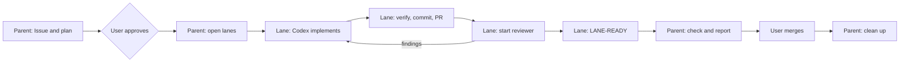

# Design

How work flows from a request to a merged pull request, which session owns each step, which skill
the agent follows there, and how the hooks verify and police the work. Decisions and their reasons
live in [`docs/adr/`](adr/).

## Development Cycle

The cycle is the same wherever the session is opened.

| Step                  | Owner         | Starts                                                                                                                                                                                                                       | Skills                                                         |
| --------------------- | ------------- | ---------------------------------------------------------------------------------------------------------------------------------------------------------------------------------------------------------------------------- | -------------------------------------------------------------- |
| 1. Issue and plan     | Parent        | —                                                                                                                                                                                                                            | `issue-workflow`                                               |
| 2. Approve            | User          | —                                                                                                                                                                                                                            | —                                                              |
| 3. Open lanes         | Parent        | a Herdr worktree and a Sonnet lane at medium effort per lane, with a brief                                                                                                                                                   | `git-workflow` (branches), `herdr-delegation`                  |
| 4. Implement          | Lane          | Codex (tests first, no commits)                                                                                                                                                                                              | `tsdd`, the language style skills, `domain-modeling`           |
| 5. Verify and deliver | Lane          | —                                                                                                                                                                                                                            | `git-workflow` (commits, delivery)                             |
| 6. Review and fix     | Lane          | an Opus subagent for Codex's code, or a read-only Codex `task` for Claude's; Codex fixes P0 and P1 findings                                                                                                                  | `git-workflow` (branches), `herdr-delegation`                  |
| 7. Report             | Lane → Parent | the lane ends with `LANE-READY`; the parent waits with `herdr agent wait` and reads it                                                                                                                                       | `herdr-delegation`                                             |
| 8. Check and report   | Parent        | —                                                                                                                                                                                                                            | —                                                              |
| 9. Merge              | User          | —                                                                                                                                                                                                                            | —                                                              |
| 10. Clean up          | Parent        | after the user merges: run `cleanup_worktrees.py` by its absolute path with the home directory expanded, as shown in the rendered `excludedCommands` entry; never remove lane worktrees by hand with `herdr worktree remove` | `git-workflow` (branches), `issue-workflow`, `source-of-truth` |

| Who                   | Does                                                                            | Never does                                              |
| --------------------- | ------------------------------------------------------------------------------- | ------------------------------------------------------- |
| User                  | approves plans, merges, pushes workflow files, deletes or archives repositories | —                                                       |
| Parent session (Opus) | Issues, plans, lanes, final check, cleanup                                      | edits files, merges                                     |
| Lane (Sonnet)         | runs Codex and the reviewer, verifies, commits, opens PRs                       | writes the implementation, types into the parent's pane |
| Codex                 | implements and fixes findings                                                   | commits or pushes (it cannot write `.git`)              |

The lane reports by ending its last message with `LANE-READY`, and the parent reads it. The lane
never types into the parent's pane, because the parent cannot tell that text from the user's.

Caution: the sandbox limits where an agent writes, not what you later run outside it, so run agent
changes only after they are reviewed and merged.

Caution: do not open a session in the home directory, because the sandbox lets a session write
everywhere under its working directory.

### Constraints

- The parent cannot write another repository's `.git`; lanes fetch, commit, and push there.
- No session writes any repository's `.git/hooks` or `.git/config`, so lanes push without `-u`.
- Run each `herdr` command and each Codex plugin call as one command: no `cd`, pipe, redirect, or `$`.
- Codex cannot reach the network or the Nix daemon; the lane updates dependencies and computes Nix hashes.
- The agent's GitHub App cannot push workflow files; the user pushes them.
- Dependencies younger than seven days are not installed (pnpm `minimumReleaseAge`, uv `exclude-newer`).

## Verification

Native provider lifecycle hooks register the session's worktree and verify changes automatically;
see [ADR-0003](adr/0003_register_verification_in_native_hooks.md).

- State lives under
  `${XDG_STATE_HOME:-~/.local/state}/agent-harness/verification/<worktree>/<session>/`.
  `results.json` there identifies the provider session and its latest check results.
- To verify a recorded session again, run
  `~/.claude/hooks/verification_session.py verify <session-directory>`. Add `--force` to rerun
  checks whose receipts are still valid. `status <session-directory>` prints the record.
- Ended or inactive records expire after seven days. Failure logs are capped at 1 MiB each and
  100 MiB in total.
- Each check may run for 300 seconds. `RUN_RELATED_TESTS_TIMEOUT_SECONDS` overrides that budget
  when it is set explicitly.

## Hook Decisions

- Denials are reserved for deny prefixes, forbidden patterns, dangerous Git operations, secret
  policies, and missing verification registration.
- A command inside an approved family whose form the precise rules do not list, a command the
  static inspection cannot decode, or a tool target outside both the worktree and the session temp
  directories is escalated to the provider's permission prompt instead; see
  [ADR-0006](adr/0006_escalate_unrecognized_command_forms_to_the_provider_prompt.md).
- Commands whose effects the sandbox contains, such as script execution, in-place edits, and
  read-only inspection with any argument, run without a prompt. Only effects that escape the
  sandbox or cannot be undone ask; see
  [ADR-0007](adr/0007_ask_only_for_effects_that_escape_the_sandbox.md), refined by
  [ADR-0009](adr/0009_review_only_commands_that_reach_past_the_sandbox.md).
- The supplementary guards judge only statically determinable shell text and ask for the rest; see
  [ADR-0015](adr/0015_judge_only_statically_determinable_shell_text_in_the_guards.md) and
  [ADR-0016](adr/0016_inspect_shell_syntax_in_the_supplementary_command_guards.md).
