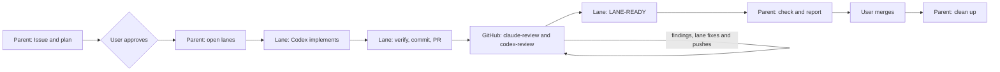

# Design

  
  

How work flows from a request to a merged pull request, which session owns each step, which skill
the agent follows there, and how the hooks verify and police the work. Decisions and their reasons
live in [`docs/adr/`](adr/).

## Development Cycle

The cycle is the same wherever the session is opened.

| Step                  | Owner         | Starts                                                                                                                                                                                                                       | Skills                                                         |
| --------------------- | ------------- | ---------------------------------------------------------------------------------------------------------------------------------------------------------------------------------------------------------------------------- | -------------------------------------------------------------- |
| 1. Issue and plan     | Parent        | —                                                                                                                                                                                                                            | `issue-workflow`                                               |
| 2. Approve            | User          | —                                                                                                                                                                                                                            | —                                                              |
| 3. Open lanes         | Parent        | a Herdr worktree and a Sonnet lane at medium effort per lane, with a brief                                                                                                                                                   | `git-workflow` (branches), `herdr-delegation`                  |
| 4. Implement          | Lane          | Codex (tests first, no commits)                                                                                                                                                                                              | `tsdd`, the language style skills, `domain-modeling`           |
| 5. Verify and deliver | Lane          | —                                                                                                                                                                                                                            | `git-workflow` (commits, delivery)                             |
| 6. Review and fix     | Lane          | the GitHub `claude-review` and `codex-review` checks; the lane fixes every finding                                                                                                                                           | `git-workflow` (delivery), `herdr-delegation`                  |
| 7. Report             | Lane → Parent | the lane ends with `LANE-READY`; the parent waits with `herdr agent wait` and reads it                                                                                                                                       | `herdr-delegation`                                             |
| 8. Check and report   | Parent        | —                                                                                                                                                                                                                            | —                                                              |
| 9. Merge              | User          | —                                                                                                                                                                                                                            | —                                                              |
| 10. Clean up          | Parent        | after the user merges: run `cleanup_worktrees.py` by its absolute path with the home directory expanded, as shown in the rendered `excludedCommands` entry; never remove lane worktrees by hand with `herdr worktree remove` | `git-workflow` (branches), `issue-workflow`, `source-of-truth` |

| Who                   | Does                                                                            | Never does                                              |
| --------------------- | ------------------------------------------------------------------------------- | ------------------------------------------------------- |
| User                  | approves plans, merges, pushes workflow files, deletes or archives repositories | —                                                       |
| Parent session (Opus) | Issues, plans, lanes, final check, cleanup                                      | edits files, merges                                     |
| Lane (Sonnet)         | runs Codex, verifies, commits, opens PRs, fixes review findings                 | writes the implementation, types into the parent's pane |
| Codex                 | implements                                                                      | commits or pushes (it cannot write `.git`)              |

The lane reports by ending its last message with `LANE-READY`, and the parent reads it. The lane
never types into the parent's pane, because the parent cannot tell that text from the user's.

Caution: the sandbox limits where an agent writes, not what you later run outside it, so run agent
changes only after they are reviewed and merged.

Caution: do not open a session in the home directory, because the sandbox lets a session write
everywhere under its working directory.

### Constraints

- The parent cannot write another repository's `.git`; lanes fetch, commit, and push there.
- No session writes any repository's `.git/hooks` or `.git/config`, so lanes push without `-u`.
- Run each `herdr` command and each Codex plugin call as one command: no `cd`, pipe, redirect, or `$`.
- Codex cannot reach the network or the Nix daemon; the lane updates dependencies and computes Nix hashes.
- The agent's GitHub App cannot push workflow files; the user pushes them.
- Dependencies younger than seven days are not installed (pnpm `minimumReleaseAge`, uv `exclude-newer`).

## Verification

Native provider lifecycle hooks register the session's worktree and verify changes automatically;
see [ADR-0003](adr/0003_register_verification_in_native_hooks.md).

- State lives under
    `${XDG_STATE_HOME:-~/.local/state}/agent-harness/verification/<worktree>/<session>/`.
    `results.json` there identifies the provider session and its latest check results.
- To verify a recorded session again, run
    `~/.claude/hooks/verification_session.py verify <session-directory>` yourself, outside the agent sandbox:
    the agent cannot write the record. Add `--force` to rerun
    checks whose receipts are still valid. `status <session-directory>` prints the record and is read-only.
- **Hook-owned state.** The receipts, the session baseline, the trusted-owner cache, the audit log, and the
    model-rule verdict cache decide what Stop reruns and what is trusted, so only the hooks, which run outside
    the sandbox, write `verification/`, `model-rules/`, `trusted-owners/`, and `audit/` under
    `agent-harness/`. The Claude sandbox keeps `~/.local/state/agent-harness` writable (the editor log lives there),
    and `agents/claude/settings.json` lists those four directories in `denyWrite`. **That sandbox rule is not in
    effect yet:** agent-harness replaces `denyWrite` with its own list when it renders the settings
    ([agent-harness#213](https://github.com/furedea/agent-harness/issues/213)), so until that is fixed a command
    that names a receipt and writes to it is not stopped. `secret_path_policy.json` already refuses file-tool
    edits that name the directories, but lets commands and read tools read them,
    because the agent reads the failure logs. Tools that run outside the sandbox
    (`excludedCommands`) are not contained by the sandbox rule even then. An unreadable or malformed record is never
    reused: Stop reports `Verification unresolved`.
- Ended or inactive records expire after seven days. Failure logs are capped at 1 MiB each and
    100 MiB in total.
- Each check may run for 300 seconds. `RUN_RELATED_TESTS_TIMEOUT_SECONDS` overrides that budget
    when it is set explicitly.
- A check's tool is looked up on the agent's `PATH` first. When it is absent and the project's
    `flake.nix` declares a dev shell, the check runs as `nix develop --no-write-lock-file --command ...` (it never writes `flake.lock`) under the same
    timeout and logs. A tool that neither `PATH` nor a dev shell provides is reported as
    `Verification unavailable`; it is not a failure and does not block Stop, but it is not a pass
    and `verify` still exits non-zero. Such a result is retried on every pass instead of reused,
    and a budget spent before the dev shell came up is reported the same way. A project that
    declares a dev shell is expected to enter it, so nix failing before the shell starts (for
    example an evaluation error in a `flake.nix` edited this session) is a failure that blocks
    Stop, with nix's output in the log. That failure is recorded as `dev_shell_failed` and, like
    `missing_tool`, is rerun on every verification instead of reused: a broken `flake.nix` blocks
    every time because nix fails fast, while a transient nix problem clears on the next Stop
    without `verify --force`.

## Model Rules at Stop

After the verification passes, the same Stop hook judges the session's changes with the model rules in
`agents/hooks/lint/model-rules/` (Python, TypeScript, Go and Rust: command/query naming M-05, error messages that name the
operation and subject M-21, known-defect markers with a removal condition M-60); see
[ADR-0021](adr/0021_enforce_prose_rules_with_each_tools_own_checks_that_report_before_they_block.md). The rules are
advisory. Five cutoffs are fitted on the rule's own fixtures (M-05 for Python, TypeScript and Rust, M-21 for
TypeScript, and M-60 for Rust); the others stay at the 0.5 starting value, which those fixtures separate with a wide margin. A fit on so
few cases is not a calibration, so the prose stays in `AGENTS.md` and the style skills until a rule is promoted.

- **Delivery.** It follows the verification receipts in `results.json`. Findings on inputs not judged before block
    Stop once, so the agent sees them. The same inputs only notify (`jev-lint: 2 findings · unchanged; not rerun`) and
    never block again. The Stop message is one line, shaped like the test lines:
    `jev-lint: 0 findings · 74 subjects · passed · $0.0004 · 4.3s`. With findings the state reads `advisory`; when the
    cap skipped subjects the count reads `judged/total` (`20/46 subjects`); a review that did not run reads
    `jev-lint: skipped · <reason>`. The cost is `spent.usd` of the review JSON, summed over the two reviews. The
    findings (`- rule · file:line`, without the rule's text) and the instruction "Fix each one, or say why it does not
    apply." appear only in the block reason. The receipt also stores the requests, cached count, seconds and cost so
    the timing can be measured later. Nothing blocks when `stop_hook_active` is set; findings kept from blocking that way are recorded as not
    yet shown and block once at the next Stop on the same inputs. The model rules get only the time the Stop hook has
    left after the verification (at most 90 seconds), and do not run when too little remains. Anything that prevents a run (the kill switch, an untrusted
    repository, a missing Keychain item, a missing `op` or `jev-lint`, a timeout, a non-zero exit, unreadable output) is
    a one-line notice and never blocks. Each child runs under `/usr/bin/timeout -s TERM -k 5 <budget>` (the
    system's, by absolute path, with only options the BSD and GNU versions share), so it still ends within its
    budget (at most 60 seconds, plus 5) if Claude Code kills the hook; without `/usr/bin/timeout` only the hook's
    own process-group kill applies (see ADR-0021).
- **What is judged.** `jev-lint review` has no single mode for "everything since the session started": with
    `--base <commit>` it judges the commits since that commit (`base...HEAD`), and without it the uncommitted changes
    and the files git does not track yet (limited here to the files the session changed since registration, so
    files that were already dirty and untouched are not sent; the rule fixtures under
    `agents/hooks/lint/model-rules/**/fixtures/**` hold violations on purpose and are never sent). The hook runs both: the first with the commit `HEAD` named at session start
    (recorded in `baseline.json`; an older record has none and only the second runs), the second always. At most 20
    subjects are judged per Stop, whole files at a time; the rest is reported as skipped. Subjects already in the
    verdict cache are not counted. A repository whose owner `trusted_owners.json` does not trust is never sent to the
    model. `AGENT_MODEL_RULES=off` turns the rules off.
- **Process boundary.** `jev-lint review --json --no-config --fail-on error -R <rules> -c <cache> [--base <commit>]`
    runs under `op run --environment <id> --`, which injects the key; `--no-config` keeps a repository's
    `.jev-lint.yaml` from redirecting the code to another endpoint. The hook passes the child only `HOME`, `USER`,
    `LANG`, `LC_ALL`, `XDG_STATE_HOME`, and `TMPDIR`, the fixed `GIT_LITERAL_PATHSPECS=1` (so git reads every path as
    a file name, never as a pathspec pattern), a `PATH` of the trusted directories below plus `/usr/bin:/bin`,
    and the service-account token to `op`. It never reads, prints, or logs the token or the key, and discards the
    stderr of `op` and `jev-lint`. A planning run (`--dry-run`, no key) counts the subjects first.
- **Which programs run.** `op` receives the token, so neither program is looked up through `PATH`: a project `bin`
    directory or any directory the agent can write to could stand earlier on it and receive the token. Both are
    started by absolute path, found only in `/etc/profiles/per-user/<user>/bin`, `/run/current-system/sw/bin`, and
    `/nix/var/nix/profiles/default/bin`, and only if the real path is inside `/nix/store` (read-only, root-owned) and
    the file is a regular, executable file owned by root that group and others cannot write. Anything else (for
    example a Homebrew `op`) is refused as `<program> is not trusted (<reason>)`, before the Keychain is read.
- **What is sent.** Only regular files whose real path is inside the repository: a symbolic link, or a file reached
    through a directory that now links elsewhere, is withheld, so that a link to `~/.ssh/config` cannot send that
    file. Both reviews name their files explicitly (the commits' files come from `git diff --name-only`). The notice
    counts the withheld files and never names them.
- **Cache.** `${XDG_STATE_HOME:-~/.local/state}/agent-harness/model-rules/verdicts.json`, shared by every repository
    and session and serialized by a lock file beside it. It is trusted input that can silence rules, so the path is in
    `secret_path_policy.json`, which refuses any tool call that names it. That guard sees paths that a tool call or
    command names literally; a command that builds the path at run time, or a program that writes it, is not covered,
    so the Claude sandbox is meant to deny writes to it as well (see Hook-owned state below for its current state).

### Setting up a new machine

The hook needs `jev-lint` and `op` installed through Nix into a system profile (dotfiles installs `jev-lint` from
agent-config; see "Which programs run") and two macOS Keychain items for the current user. Do this once per machine.

1. In 1Password, create a service account with read-only access to the Environment `jev` and its dedicated vault.
    Copy the token (it starts with `ops_`) and the Environment ID. The ID is not a UUID: it is lowercase letters and
    digits.
2. Store both in the login Keychain. Leave the value off the command line so that it prompts and the value stays out
    of the shell history:
    `security add-generic-password -a "$USER" -s agent-model-rules-op-token -w` and
    `security add-generic-password -a "$USER" -s agent-model-rules-op-environment -w`.
3. Check that both exist without printing them:
    `security find-generic-password -a "$USER" -s agent-model-rules-op-token` and the same with
    `-s agent-model-rules-op-environment` (without `-w` they print attributes, not the value).
4. Check that `op` can inject the key without a prompt, printing only whether it is present:
    `OP_SERVICE_ACCOUNT_TOKEN="$(security find-generic-password -a "$USER" -s agent-model-rules-op-token -w)" op run --environment "<id>" -- sh -c 'test -n "$TYPESAFE_API_KEY" && echo present'`.

Without the items, the hook reports `Model rules skipped` at every Stop and does nothing else.

## Hook Decisions

- Denials are reserved for deny prefixes, forbidden patterns, dangerous Git operations, secret
    policies, and missing verification registration.
- A command inside an approved family whose form the precise rules do not list, a command the
    static inspection cannot decode, or a tool target outside both the worktree and the session temp
    directories is escalated to the provider's permission prompt instead; see
    [ADR-0006](adr/0006_escalate_unrecognized_command_forms_to_the_provider_prompt.md).
- Commands whose effects the sandbox contains, such as script execution, in-place edits, and
    read-only inspection with any argument, run without a prompt. Only effects that escape the
    sandbox or cannot be undone ask; see
    [ADR-0007](adr/0007_ask_only_for_effects_that_escape_the_sandbox.md), refined by
    [ADR-0009](adr/0009_review_only_commands_that_reach_past_the_sandbox.md).
- Docker runs outside the sandbox, so only its read-only inspection forms run without a prompt and
    every other form asks; see
    [ADR-0017](adr/0017_ask_for_every_docker_form_the_allowlist_does_not_list.md).
- `agent-browser` and `agent-desktop` run outside the sandbox, and their listed forms run without
    a prompt. `file:` and `chrome:` URLs, and terminals, System Settings, and credential apps, are
    denied, and forms that reach logged-in sessions or unnamed targets ask; see
    [ADR-0018](adr/0018_allow_browser_and_desktop_automation_except_named_risky_forms.md). Each
    subcommand may use only the options listed for it, and its arguments must resolve, through
    symlinks, inside the worktree or the session's temporary directory, or the call asks, and so
    does every file the browser daemon writes but a bare screenshot; see
    [ADR-0019](adr/0019_resolve_automation_path_arguments_through_symlinks.md).
- The supplementary guards judge only statically determinable shell text and ask for the rest; see
    [ADR-0015](adr/0015_judge_only_statically_determinable_shell_text_in_the_guards.md) and
    [ADR-0016](adr/0016_inspect_shell_syntax_in_the_supplementary_command_guards.md).
- The provider's own `ask` prefixes are kept for commands that widen authority (fetched or
    unpinned code, containers, other people's workspaces, outside hosts) or promote work and cannot be
    undone (merge, release, stash drop, remote changes, signals, the Herdr server); an `ask` rule still
    prompts in Claude Code's auto mode. Dependency changes run unprompted.
- `rm` runs unprompted for files inside the worktree and the session's temporary directories. The
    command guard asks for Git metadata, any other path (resolved through links in its parent
    directories), a path known only at run time, xargs operands, and recursive forms the deny
    prefixes do not list.
- Typing into a Herdr pane (`pane send-text`, `pane send-keys`, `pane run`, `agent send-keys`)
    runs unprompted only while the target is the pane of an agent this session started and that
    agent still runs there; any other pane asks.
