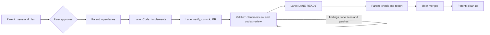

# 設計

  
  

依頼からマージ済みのプルリクエストまで作業がどう流れるか，各ステップをどのセッションが担うか，そこでエージェントがどのスキルに従うか，フックが作業をどう検証し取り締まるか．判断とその理由は [`docs/adr/`](adr/) にある．

## 開発サイクル

セッションをどこで開いても，サイクルは同じである．

| ステップ              | 担当          | 開始                                                                                                                                                                                                                              | スキル                                                         |
| --------------------- | ------------- | --------------------------------------------------------------------------------------------------------------------------------------------------------------------------------------------------------------------------------- | -------------------------------------------------------------- |
| 1. Issue and plan     | Parent        | —                                                                                                                                                                                                                                 | `issue-workflow`                                               |
| 2. Approve            | User          | —                                                                                                                                                                                                                                 | —                                                              |
| 3. Open lanes         | Parent        | レーンごとに，Herdr の worktree と medium effort の Sonnet レーンを，brief 付きで                                                                                                                                                 | `git-workflow` (branches), `herdr-delegation`                  |
| 4. Implement          | Lane          | Codex（テストが先，コミットなし）                                                                                                                                                                                                 | `tsdd`, 各言語のスタイルスキル，`domain-modeling`              |
| 5. Verify and deliver | Lane          | —                                                                                                                                                                                                                                 | `git-workflow` (commits, delivery)                             |
| 6. Review and fix     | Lane          | GitHub の `claude-review` と `codex-review`．レーンがすべての指摘を修正する                                                                                                                                                       | `git-workflow` (delivery), `herdr-delegation`                  |
| 7. Report             | Lane → Parent | レーンは `LANE-READY` で終わり，親は `herdr agent wait` で待ってそれを読む                                                                                                                                                        | `herdr-delegation`                                             |
| 8. Check and report   | Parent        | —                                                                                                                                                                                                                                 | —                                                              |
| 9. Merge              | User          | —                                                                                                                                                                                                                                 | —                                                              |
| 10. Clean up          | Parent        | ユーザーがマージした後：レンダリングされた `excludedCommands` のエントリに示されるとおり，ホームディレクトリを展開した絶対パスで `cleanup_worktrees.py` を実行する．レーンの worktree を `herdr worktree remove` で手で削除しない | `git-workflow` (branches), `issue-workflow`, `source-of-truth` |

| 誰                    | すること                                                                      | 決してしないこと                     |
| --------------------- | ----------------------------------------------------------------------------- | ------------------------------------ |
| User                  | 計画の承認，マージ，ワークフローファイルの push，リポジトリの削除やアーカイブ | —                                    |
| Parent session (Opus) | Issue，計画，レーン，最終確認，クリーンアップ                                 | ファイルの編集，マージ               |
| Lane (Sonnet)         | Codex の実行，検証，コミット，PR の作成，レビュー指摘の修正                   | 実装を書く，親のペインに入力する     |
| Codex                 | 実装                                                                          | コミットや push（`.git` に書けない） |

レーンは最後のメッセージを `LANE-READY` で終えて報告し，親がそれを読む．親はその文字列とユーザーの入力を区別できないので，レーンは親のペインに入力しない．

注意：サンドボックスが制限するのはエージェントの書き込み先であり，その外であとから実行するものではない．そのため，エージェントの変更は，レビューしてマージした後にだけ実行すること．

注意：サンドボックスはセッションが作業ディレクトリ以下のあらゆる場所に書き込めるようにするので，ホームディレクトリでセッションを開かないこと．

### 制約

- 親は他のリポジトリの `.git` に書き込めない．そこでの fetch，コミット，push はレーンが行う．
- どのセッションも，どのリポジトリの `.git/hooks` と `.git/config` にも書き込めないので，レーンは `-u` なしで push する．
- 各 `herdr` コマンドと各 Codex プラグインの呼び出しは 1 つのコマンドとして実行する：`cd`，パイプ，リダイレクト，`$` は使わない．
- Codex はネットワークにも Nix デーモンにも届かないので，依存関係の更新と Nix のハッシュの計算はレーンが行う．
- エージェントの GitHub App はワークフローファイルを push できないので，ユーザーが push する．
- 公開から 7 日未満の依存関係はインストールしない（pnpm の `minimumReleaseAge`，uv の `exclude-newer`）．

## 検証

プロバイダのネイティブなライフサイクルフックが，セッションの worktree を登録し，変更を自動的に検証する．[ADR-0003](adr/0003_register_verification_in_native_hooks.md) を参照．

- 状態は `${XDG_STATE_HOME:-~/.local/state}/agent-harness/verification/<worktree>/<session>/` の下にある．そこの `results.json` が，プロバイダのセッションと最新のチェック結果を識別する．
- 記録済みのセッションを再び検証するには，`~/.claude/hooks/verification_session.py verify <session-directory>` を，エージェントの sandbox の外でユーザー自身が実行する（エージェントは記録を書けない）．レシートがまだ有効なチェックも再実行するには `--force` を付ける．`status <session-directory>` は記録を表示するだけで，書き込まない．
- **hook だけが書く状態．** 検証レシート，セッションの baseline，信頼済みオーナーのキャッシュ，監査ログ，モデルルールの verdict cache は，Stop が何を再実行し，何を信頼するかを決める．そのため sandbox の外で動く hook だけが `agent-harness/` 配下の `verification/`，`model-rules/`，`trusted-owners/`，`audit/` に書く．Claude の sandbox は `~/.local/state/agent-harness` 自体への書き込みを許し（エディタのログがある），`agents/claude/settings.json` の `denyWrite` にこの 4 つのディレクトリを書いてある．**この sandbox の規則はまだ効いていない．** agent-harness が設定をレンダリングするとき `denyWrite` を自身の一覧で置き換えるため（[agent-harness#213](https://github.com/furedea/agent-harness/issues/213)），直るまでは，レシートを名指しして書き込むコマンドは止まらない．`secret_path_policy.json` は，これらを名指しするファイルツールの編集を今すぐ拒否するが，コマンドや読み取りツールからの読み取りは許す（エージェントが失敗ログを読むため）．sandbox の外で動くツール（`excludedCommands`）は，直ったあともこの sandbox の規則では防げない．読めない記録や壊れた記録は再利用せず，Stop は `Verification unresolved` と報告する．
- 終了または非アクティブになった記録は 7 日で失効する．失敗ログは 1 件あたり 1 MiB，合計 100 MiB までに制限される．
- 各チェックは 300 秒まで実行できる．`RUN_RELATED_TESTS_TIMEOUT_SECONDS` を明示的に設定すると，その上限を上書きする．
- チェックのツールはまずエージェントの `PATH` から探す．見つからず，プロジェクトの `flake.nix` が dev shell を宣言していれば，同じタイムアウトとログのまま `nix develop --no-write-lock-file --command ...` で実行する（`flake.lock` は書き込まない）．`PATH` にも dev shell にも無いツールは `Verification unavailable` と報告する．これは失敗ではなく Stop をブロックしないが，成功でもないため，`verify` は 0 以外で終了する．この結果は再利用せず毎回再試行する．dev shell を宣言しているプロジェクトは dev shell に入れる前提なので，nix が dev shell に入る前にエラーで終了した場合（`flake.nix` の評価エラーなど）は失敗として Stop をブロックし，nix の出力をログに残す．この失敗は `dev_shell_failed` として記録し，`missing_tool` と同様に再利用せず検証のたびに再実行する．`flake.nix` が壊れていれば nix がすぐ失敗するので毎回ブロックし，一時的な nix の問題なら `verify --force` なしで次の Stop で解消する．起動前に予算を使い切った場合だけは同じ「利用不可」として扱い，毎回再試行する．

## Stop 時のモデルルール

検証が通ったあと，同じ Stop フックがセッションの変更を `agents/hooks/lint/model-rules/` のモデルルールで採点する．対象は Python と TypeScript で，コマンド/クエリ命名（M-05），エラーメッセージが操作と対象を示すこと（M-21），既知の欠陥マーカーに除去条件を添えること（M-60）の 3 つ．[ADR-0021](adr/0021_enforce_prose_rules_with_each_tools_own_checks_that_report_before_they_block.md) を参照．ルールは助言であり，しきい値は未調整なので，昇格するまでは `AGENTS.md` とスタイルスキルの文章を残す．

- **渡し方．** `results.json` の検証レシートと同じ方式にする．まだ採点していない入力に対する指摘は Stop を 1 回だけブロックし，エージェントに見せる．同じ入力では通知だけにし（`jev-lint: 2 findings · unchanged; not rerun`），二度とブロックしない．Stop の表示はテストの行と同じ形の 1 行で，`jev-lint: 0 findings · 74 subjects · passed · $0.0004 · 4.3s` とする．指摘があれば状態は `advisory`，上限で見送った対象があれば件数は `判定した数/全体` (`20/46 subjects`)，実行できなかったときは `jev-lint: skipped · <理由>` と出す．費用はレビュー JSON の `spent.usd` を 2 回のレビューで合計した値である．指摘（ルールの文章は繰り返さず `- rule · file:line`）と「Fix each one, or say why it does not apply.」はブロックの reason にだけ出す．レシートには，あとで時間を測れるよう，リクエスト数，キャッシュ数，秒数，費用も保存する．`stop_hook_active` が立っているときはブロックしないが，そうして見せられなかった指摘は「未提示」として記録し，同じ入力の次の Stop で 1 回だけブロックする．モデルルールが使える時間は，検証が使った分を引いた Stop の残り時間までで，足りなければ実行しない．実行できなかった場合（キルスイッチ，信頼されないリポジトリ，Keychain 項目の欠落，`op` や `jev-lint` の欠落，タイムアウト，0 以外の終了，読めない出力）は 1 行の通知にとどめ，ブロックしない．子プロセスは `/usr/bin/timeout -s TERM -k 5 <予算>` の下で起動する（システムのものを絶対パスで呼び，BSD 版と GNU 版が共通で受け付けるオプションだけを使う）．そのため Claude Code が hook を強制終了しても，予算（最大 60 秒，加えて 5 秒）の内に終わる．`/usr/bin/timeout` が無ければ hook 自身の process group の kill だけになる（ADR-0021）．
- **何を採点するか．** `jev-lint review` には「セッション開始以降すべて」を 1 回で採点するモードがない．`--base <commit>` はそのコミット以降のコミット（`base...HEAD`）を，指定しなければ未コミットの変更と git が追跡していないファイルを採点する（こちらは，登録以降にセッションが変えたファイルだけに限る．最初から dirty で触っていないファイルは送らない．`agents/hooks/lint/model-rules/**/fixtures/**` のルールの例は，わざと違反を含むので送らない）．そこでフックは両方を実行する．前者にはセッション開始時に `HEAD` が指していたコミット（`baseline.json` に記録．古い記録には無く，その場合は後者のみ）を渡し，後者は常に実行する．1 回の Stop で採点する対象は最大 20 個で，ファイル単位でまとめて採り，残りはスキップとして報告する．判定キャッシュにある対象は数えない．`trusted_owners.json` が信頼しない所有者のリポジトリは，モデルに送らない．`AGENT_MODEL_RULES=off` でルールを止められる．
- **キャッシュ．** `${XDG_STATE_HOME:-~/.local/state}/agent-harness/model-rules/verdicts.json`．全リポジトリとセッションで共有し，隣のロックファイルで直列化する．ルールを黙らせうる信頼された入力なので，そのパスを `secret_path_policy.json` に入れ，パスを名指しするツール呼び出しを拒否する．この guard が見るのは，ツール呼び出しやコマンドが文字どおり名指しするパスだけである．実行時にパスを組み立てるコマンドや，書き込むプログラムは対象外なので，Claude の sandbox にもこのディレクトリへの書き込みを拒否させる（現状は上の「hook だけが書く状態」）．
- **プロセス境界．** `jev-lint review --json --no-config --fail-on error -R <rules> -c <cache> [--base <commit>]` を `op run --environment <id> --` の下で実行し，キーは `op` が注入する．`--no-config` は，リポジトリの `.jev-lint.yaml` がコードの送り先を別のエンドポイントに変えるのを防ぐ．子プロセスに渡す環境変数は `HOME`，`USER`，`LANG`，`LC_ALL`，`XDG_STATE_HOME`，`TMPDIR`，下記の信頼ディレクトリと `/usr/bin:/bin` だけの `PATH` で，`op` にだけサービスアカウントのトークンを加える．トークンもキーも，読まず，表示せず，記録せず，`op` と `jev-lint` の標準エラーは捨てる．先に（キー不要の）`--dry-run` で対象数を数える．
- **起動するプログラム．** `op` はトークンを受け取るため，どちらのプログラムも `PATH` からは探さない．プロジェクトの `bin` やエージェントが書き込めるディレクトリが `PATH` の先頭にあると，偽の `op` がトークンを受け取りうる．どちらも絶対パスで起動し，`/etc/profiles/per-user/<user>/bin`，`/run/current-system/sw/bin`，`/nix/var/nix/profiles/default/bin` からだけ探す．実体のパスが `/nix/store`（読み取り専用で root 所有）の中にあり，root 所有で group と others が書き込めない通常の実行可能ファイルのときだけ使う．それ以外（たとえば Homebrew の `op`）は，Keychain を読む前に `<program> is not trusted (<理由>)` として拒否する．
- **送るもの．** リポジトリ内に実体がある通常ファイルだけを送る．シンボリックリンクと，リンクに置き換わったディレクトリ経由のファイルは送らず，`~/.ssh/config` へのリンクでその内容が送られるのを防ぐ．2 つのレビューとも対象ファイルを明示して渡す（コミット側は `git diff --name-only` から得る）．送らなかったファイルは件数だけを通知し，名前は出さない．

### 新しいマシンの準備

フックには Nix でシステムプロファイルに入れた `jev-lint` と `op`（`jev-lint` は dotfiles が agent-config から入れる．「起動するプログラム」を参照），そして現在のユーザーの macOS Keychain 項目が 2 つ必要．マシンごとに 1 回だけ行う．

1. 1Password で，Environment `jev` とその専用 vault に読み取り専用でアクセスできるサービスアカウントを作る．トークン（`ops_` で始まる）と Environment ID を控える．ID は UUID ではなく，英小文字と数字である．
2. 両方をログインキーチェーンに保存する．値をコマンドラインに書かず，プロンプトに入力すれば，シェル履歴に残らない．`security add-generic-password -a "$USER" -s agent-model-rules-op-token -w` と `security add-generic-password -a "$USER" -s agent-model-rules-op-environment -w`．
3. 値を表示せずに，両方あることを確かめる．`security find-generic-password -a "$USER" -s agent-model-rules-op-token` と，`-s agent-model-rules-op-environment` で同じことをする（`-w` を付けなければ属性だけが出て，値は出ない）．
4. `op` がプロンプト無しでキーを注入できることを，有無だけ表示して確かめる．`OP_SERVICE_ACCOUNT_TOKEN="$(security find-generic-password -a "$USER" -s agent-model-rules-op-token -w)" op run --environment "<id>" -- sh -c 'test -n "$TYPESAFE_API_KEY" && echo present'`．

項目が無ければ，フックは Stop のたびに `Model rules skipped` と報告するだけで，ほかには何もしない．

## フックの判断

- 拒否は，deny プレフィックス，禁止パターン，危険な Git 操作，シークレットのポリシー，検証登録の欠落に限る．
- 承認済みのファミリー内にあって，精密なルールに載っていない形式のコマンド，静的な検査で解読できないコマンド，worktree とセッションの一時ディレクトリのどちらの外にもあるツールの対象は，拒否せずプロバイダの権限プロンプトに回す．[ADR-0006](adr/0006_escalate_unrecognized_command_forms_to_the_provider_prompt.md) を参照．
- スクリプトの実行，インプレースの編集，任意の引数での読み取り専用の調査など，影響をサンドボックスが封じ込めるコマンドは，プロンプトなしで実行する．サンドボックスを越える，または元に戻せない影響だけが確認を求める．[ADR-0007](adr/0007_ask_only_for_effects_that_escape_the_sandbox.md) を参照．これは [ADR-0009](adr/0009_review_only_commands_that_reach_past_the_sandbox.md) で具体化されている．
- Docker はサンドボックスの外で動くため，読み取り専用の調査だけをプロンプトなしで実行し，それ以外の形式はすべて確認を求める．[ADR-0017](adr/0017_ask_for_every_docker_form_the_allowlist_does_not_list.md) を参照．
- `agent-browser` と `agent-desktop` はサンドボックスの外で動き，許可された形式はプロンプトなしで実行する．`file:` と `chrome:` の URL，ターミナル，システム設定，認証情報のアプリは拒否し，ログイン済みのセッションや名前のない対象に届く形式は確認を求める．[ADR-0018](adr/0018_allow_browser_and_desktop_automation_except_named_risky_forms.md) を参照．各サブコマンドは一覧にあるオプションだけを使え，それ以外のオプションは確認を求める．引数はシンボリックリンクをたどって worktree かセッションの一時ディレクトリの中に解決できなければ確認を求める．ブラウザーの daemon が書き込むファイルは，パスを指定しない screenshot を除いて確認を求める．[ADR-0019](adr/0019_resolve_automation_path_arguments_through_symlinks.md) を参照．
- 補助のガードは，静的に判定できるシェルのテキストだけを判定し，残りは確認を求める．[ADR-0015](adr/0015_judge_only_statically_determinable_shell_text_in_the_guards.md) と [ADR-0016](adr/0016_inspect_shell_syntax_in_the_supplementary_command_guards.md) を参照．
