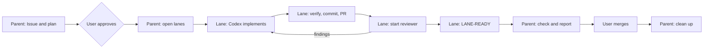

# 設計

  
  

依頼からマージ済みのプルリクエストまで作業がどう流れるか，各ステップをどのセッションが担うか，そこでエージェントがどのスキルに従うか，フックが作業をどう検証し取り締まるか．判断とその理由は [`docs/adr/`](adr/) にある．

## 開発サイクル

セッションをどこで開いても，サイクルは同じである．

| ステップ              | 担当          | 開始                                                                                                                                                                                                                              | スキル                                                         |
| --------------------- | ------------- | --------------------------------------------------------------------------------------------------------------------------------------------------------------------------------------------------------------------------------- | -------------------------------------------------------------- |
| 1. Issue and plan     | Parent        | —                                                                                                                                                                                                                                 | `issue-workflow`                                               |
| 2. Approve            | User          | —                                                                                                                                                                                                                                 | —                                                              |
| 3. Open lanes         | Parent        | レーンごとに，Herdr の worktree と medium effort の Sonnet レーンを，brief 付きで                                                                                                                                                 | `git-workflow` (branches), `herdr-delegation`                  |
| 4. Implement          | Lane          | Codex（テストが先，コミットなし）                                                                                                                                                                                                 | `tsdd`, 各言語のスタイルスキル，`domain-modeling`              |
| 5. Verify and deliver | Lane          | —                                                                                                                                                                                                                                 | `git-workflow` (commits, delivery)                             |
| 6. Review and fix     | Lane          | Codex のコードには Opus のサブエージェント，Claude のコードには読み取り専用の Codex `task`．Codex が P0 と P1 の指摘を修正する                                                                                                    | `git-workflow` (branches), `herdr-delegation`                  |
| 7. Report             | Lane → Parent | レーンは `LANE-READY` で終わり，親は `herdr agent wait` で待ってそれを読む                                                                                                                                                        | `herdr-delegation`                                             |
| 8. Check and report   | Parent        | —                                                                                                                                                                                                                                 | —                                                              |
| 9. Merge              | User          | —                                                                                                                                                                                                                                 | —                                                              |
| 10. Clean up          | Parent        | ユーザーがマージした後：レンダリングされた `excludedCommands` のエントリに示されるとおり，ホームディレクトリを展開した絶対パスで `cleanup_worktrees.py` を実行する．レーンの worktree を `herdr worktree remove` で手で削除しない | `git-workflow` (branches), `issue-workflow`, `source-of-truth` |

| 誰                    | すること                                                                      | 決してしないこと                     |
| --------------------- | ----------------------------------------------------------------------------- | ------------------------------------ |
| User                  | 計画の承認，マージ，ワークフローファイルの push，リポジトリの削除やアーカイブ | —                                    |
| Parent session (Opus) | Issue，計画，レーン，最終確認，クリーンアップ                                 | ファイルの編集，マージ               |
| Lane (Sonnet)         | Codex とレビュアーの実行，検証，コミット，PR の作成                           | 実装を書く，親のペインに入力する     |
| Codex                 | 実装と指摘の修正                                                              | コミットや push（`.git` に書けない） |

レーンは最後のメッセージを `LANE-READY` で終えて報告し，親がそれを読む．親はその文字列とユーザーの入力を区別できないので，レーンは親のペインに入力しない．

注意：サンドボックスが制限するのはエージェントの書き込み先であり，その外であとから実行するものではない．そのため，エージェントの変更は，レビューしてマージした後にだけ実行すること．

注意：サンドボックスはセッションが作業ディレクトリ以下のあらゆる場所に書き込めるようにするので，ホームディレクトリでセッションを開かないこと．

### 制約

- 親は他のリポジトリの `.git` に書き込めない．そこでの fetch，コミット，push はレーンが行う．
- どのセッションも，どのリポジトリの `.git/hooks` と `.git/config` にも書き込めないので，レーンは `-u` なしで push する．
- 各 `herdr` コマンドと各 Codex プラグインの呼び出しは 1 つのコマンドとして実行する：`cd`，パイプ，リダイレクト，`$` は使わない．
- Codex はネットワークにも Nix デーモンにも届かないので，依存関係の更新と Nix のハッシュの計算はレーンが行う．
- エージェントの GitHub App はワークフローファイルを push できないので，ユーザーが push する．
- 公開から 7 日未満の依存関係はインストールしない（pnpm の `minimumReleaseAge`，uv の `exclude-newer`）．

## 検証

プロバイダのネイティブなライフサイクルフックが，セッションの worktree を登録し，変更を自動的に検証する．[ADR-0003](adr/0003_register_verification_in_native_hooks.md) を参照．

- 状態は `${XDG_STATE_HOME:-~/.local/state}/agent-harness/verification/<worktree>/<session>/` の下にある．そこの `results.json` が，プロバイダのセッションと最新のチェック結果を識別する．
- 記録済みのセッションを再び検証するには，`~/.claude/hooks/verification_session.py verify <session-directory>` を実行する．レシートがまだ有効なチェックも再実行するには `--force` を付ける．`status <session-directory>` は記録を表示する．
- 終了または非アクティブになった記録は 7 日で失効する．失敗ログは 1 件あたり 1 MiB，合計 100 MiB までに制限される．
- 各チェックは 300 秒まで実行できる．`RUN_RELATED_TESTS_TIMEOUT_SECONDS` を明示的に設定すると，その上限を上書きする．

## フックの判断

- 拒否は，deny プレフィックス，禁止パターン，危険な Git 操作，シークレットのポリシー，検証登録の欠落に限る．
- 承認済みのファミリー内にあって，精密なルールに載っていない形式のコマンド，静的な検査で解読できないコマンド，worktree とセッションの一時ディレクトリのどちらの外にもあるツールの対象は，拒否せずプロバイダの権限プロンプトに回す．[ADR-0006](adr/0006_escalate_unrecognized_command_forms_to_the_provider_prompt.md) を参照．
- スクリプトの実行，インプレースの編集，任意の引数での読み取り専用の調査など，影響をサンドボックスが封じ込めるコマンドは，プロンプトなしで実行する．サンドボックスを越える，または元に戻せない影響だけが確認を求める．[ADR-0007](adr/0007_ask_only_for_effects_that_escape_the_sandbox.md) を参照．これは [ADR-0009](adr/0009_review_only_commands_that_reach_past_the_sandbox.md) で具体化されている．
- Docker はサンドボックスの外で動くため，読み取り専用の調査だけをプロンプトなしで実行し，それ以外の形式はすべて確認を求める．[ADR-0017](adr/0017_ask_for_every_docker_form_the_allowlist_does_not_list.md) を参照．
- 補助のガードは，静的に判定できるシェルのテキストだけを判定し，残りは確認を求める．[ADR-0015](adr/0015_judge_only_statically_determinable_shell_text_in_the_guards.md) と [ADR-0016](adr/0016_inspect_shell_syntax_in_the_supplementary_command_guards.md) を参照．
